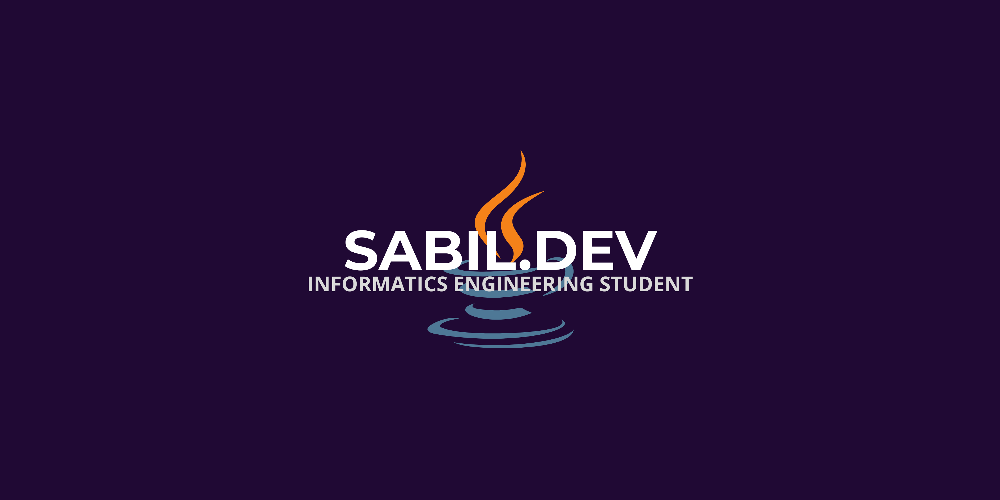

  

# Halo, Saya Sabil! 👋

  
  

Saya adalah mahasiswa **Teknik Informatika** yang tertarik dalam dunia pemrograman web, eksplorasi kecerdasan buatan (AI), dan teknologi digital. Saya senang mempelajari hal baru dan membangun proyek-proyek coding yang bermanfaat.

---

### 🚀 Tech Stack & Tools yang Saya Gunakan:

  <!-- HTML5 -->
  
  <!-- JavaScript -->
  
  <!-- VS Code -->
  
  <!-- Git -->
  
  <!-- GitHub -->
  

---

### 📊 Statistik GitHub Saya:

  

---

*“Keep coding, stay curious, and always keep learning!”* 💻✨
